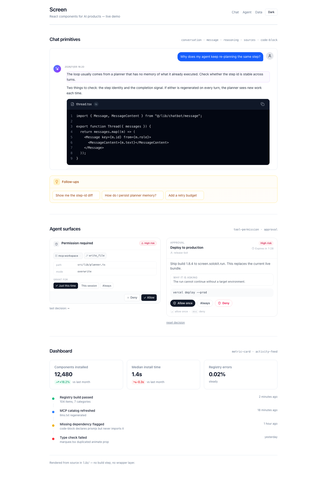
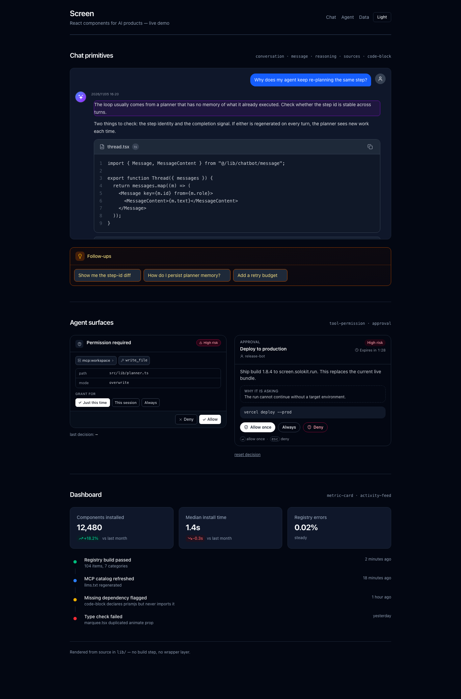

# Screen

Production-ready React components for AI products — chat, agents, docs, dashboards and marketing.

**104 components across 7 categories. One file each, one theme.** Copy a file into your project and you own it.

This repository holds the component source and the shadcn registry. The website at [screen.solokit.run](https://screen.solokit.run) is a separate private app.

## Install

### With the shadcn CLI

```bash
npx shadcn@latest add "https://screen.solokit.run/r/conversation"
```

The registry is free to copy. Swap the component name for anything in `registry.json`.

### Let your editor do it

Screen exposes an MCP server with no API key. Point Claude Code, Cursor or Codex at it:

```bash
# Codex
codex mcp add solokit --url https://screen.solokit.run/api/mcp

# Claude Code
claude mcp add --transport http solokit https://screen.solokit.run/api/mcp
```

Tools: `list_components`, `search_components`, `get_component`, `get_source`.

An agent can also read [`llms.txt`](https://screen.solokit.run/llms.txt) for the full index.

### Copy by hand

Every component is a single file under `lib/<category>/`. Copy it, fix the `@/lib/utils` import to your own path alias, install whatever the file imports, done.

## What's inside

| Category | Items | Path |
| --- | --- | --- |
| Agent | 23 | `lib/agent/` — run controls, traces, approvals, checkpoints, task lists, diff, terminal |
| Marketing | 16 | `lib/marketing/` — heroes, feature grids, pricing, testimonials, FAQ, CTA, logo banners |
| Animation | 15 | `lib/animation/` — typewriter, shimmer, motion primitives |
| Chatbot | 14 | `lib/chatbot/` — conversation, message, reasoning, tool invocation, sources, suggestions |
| Docs | 12 | `lib/docs/` — layout, sidebar, search, TOC, breadcrumb, code highlight |
| Dashboard | 12 | `lib/dashboard/` — metric cards, activity feeds, status indicators, tables |
| Form | 12 | `lib/form/` — inputs, validation states, multi-step flows |

Plus 13 composable blocks (`registry:block`) such as `dashboard-layout`, `stats-grid`, `pricing-section` and `login-form`, and the shared primitives in `components/ui/`.

## Requirements

- React 19 (React 18 works for most components)
- Tailwind CSS 4
- TypeScript recommended
- `lib/docs/` additionally expects Next.js App Router and `next-intl`

## Theming

Components read design tokens from CSS variables, so light and dark mode come for free. The theme presets and the visual editor live in `lib/theme/`. Import `ThemeProvider` from `lib/theme-provider.tsx` to wire tokens at runtime.

### Import the theme layer first

Tailwind 4 points the `dark:` variant at `prefers-color-scheme`, not at a class.
`ThemeProvider` toggles `.dark` on `<html>`, so the variant has to be redefined
or every dark style silently does nothing.

`styles/screen.css` already does this, together with the token definitions every
component reads from:

```css
/* your globals.css */
@import "tailwindcss";
@import "./styles/screen.css";   /* copy it in, or import it from node_modules */
```

That is the whole setup. Without it the app still "switches theme" — the CSS
variables change — but any component using `dark:` utilities keeps its light
styling. This is the most common integration mistake with this library.

If you would rather define tokens yourself, the one line that matters is:

```css
@custom-variant dark (&:where(.dark, .dark *));
```

### Set the class before the first paint

Add this to `<head>`, ahead of your app bundle. Resolving the theme in a React
effect instead means components render light first and then flip — and anything
carrying a `transition` (the suggestion chips do) can stay stuck at its starting
colour:

```html
<script>
  (function () {
    var q = new URLSearchParams(location.search).get("theme");
    var stored = null;
    try { stored = localStorage.getItem("solokit-theme-mode"); } catch (e) {}
    var choice = q || stored || "system";
    var dark =
      choice === "dark" ||
      (choice === "system" &&
        window.matchMedia("(prefers-color-scheme: dark)").matches);
    document.documentElement.classList.toggle("dark", dark);
  })();
</script>
```

### Tokens

`ThemeProvider` writes `solokit-theme-mode` to `localStorage` (exported as
`THEME_STORAGE_KEY`). Values are validated against `light` / `dark` / `system`;
an unrecognised value falls back to `system`.

## Develop

```bash
pnpm install
pnpm typecheck        # tsc --noEmit
pnpm test             # vitest — 72 tests
pnpm test:coverage    # coverage report
pnpm demo             # live demo on http://localhost:4318
pnpm registry:build   # rebuild public/r/*.json from registry.json
pnpm verify           # typecheck + test + registry build
```

## Demo

`demo/` is a Vite app that imports components through the same `@/` alias the
registry uses — no wrapper layer, no mocked data source. `pnpm demo`, open
http://localhost:4318. It covers the chat primitives (conversation, message,
reasoning, sources, code block, loader, suggestions), the agent approval
surfaces, and the dashboard cards.

Add `?theme=dark` to pin the theme when sharing a link or taking a screenshot.

| Light | Dark |
| --- | --- |
|  |  |

## Security

See [SECURITY.md](./SECURITY.md) for the disclosure policy and for the
boundaries consumers must respect. Two matter more than the rest:

- `ToolPermission` and `ApprovalCard` are UI. They do not authorize anything.
- Nothing in this library sanitizes HTML. Sanitize model or third-party content
  before rendering it.

A pre-publication review covering code, data exposure and supply chain is in
[docs/security-review.md](./docs/security-review.md).

## License

[MIT](./LICENSE). Use it commercially, in unlimited client projects, white-label it, ship it. Attribution is appreciated but not required.

## Acknowledgements

The component API shape for the chat primitives (`Conversation`, `Message`, `Reasoning`, `Sources`) follows the conventions popularised by [Vercel AI Elements](https://github.com/vercel/ai-elements). The implementations here are independent and built on a different foundation (no `use-stick-to-bottom`, no AI SDK coupling). Shout out to [shadcn/ui](https://ui.shadcn.com) for the registry model.
